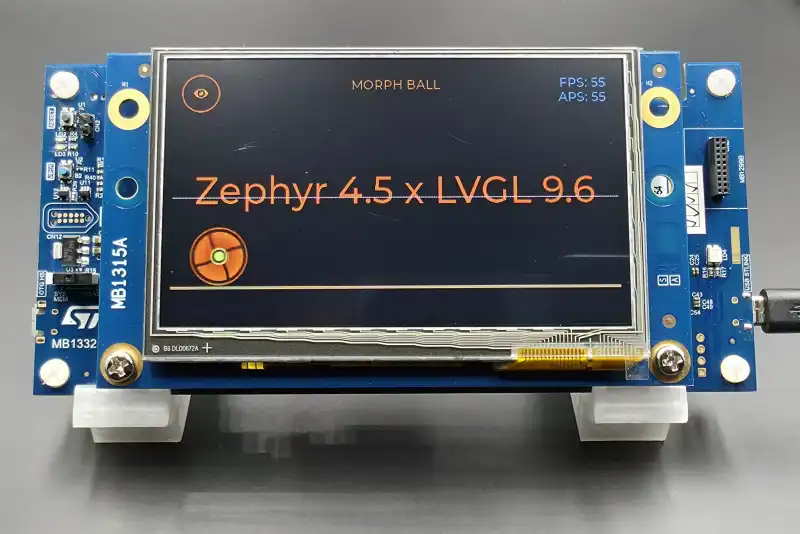

# STM32H7B3I-DK — Morph Ball Demo

**Zephyr RTOS × LVGL × STM32H7**

A demonstration of **Zephyr RTOS 4.5.0** and **LVGL 9.6.0** running on the **STM32H7B3I-DK** development board.

The application features an animated Morph Ball inspired by the *Metroid* series, demonstrating image transformations, touchscreen interaction, hardware display acceleration, and runtime performance monitoring.

The implementation achieves **55 FPS** using LVGL partial refresh, double buffering, STM32 DMA2D acceleration, and external SDRAM.

> "Why a Morph Ball?"
>
> — Because blinking LEDs is getting boring. 😎

---

## Screenshots



---

## Hardware

| Component | Description |
|---|---|
| Development board | STM32H7B3I-DK |
| Microcontroller | STM32H7B3LIH6Q |
| CPU | Arm Cortex-M7 |
| Display | Rocktech RK043FN48H-CT672B 4.3" TFT LCD |
| Resolution | 480 × 272 |
| Pixel format | RGB565 |
| Display controller | STM32 LTDC |
| Graphics accelerator | STM32 DMA2D |
| Touch controller | FT5336 |
| Framebuffer memory | External SDRAM |

The application uses the native Zephyr board definition:

`stm32h7b3i_dk`

No STM32CubeIDE, TouchGFX, or external BSP is required.

---

## Features

- Animated 64 × 64 Morph Ball sprite with transparency.
- Dynamic green energy glow beneath the Morph Ball.
- Yellow impact flash using LVGL image recoloring.
- Smooth acceleration and deceleration with position-synchronized rotation.
- Continuous horizontal movement with automatic direction reversal at screen boundaries.
- Position-based rotation simulating rolling without slipping.
- Touch interaction for reversing movement direction.
- LVGL 9.6 image transformations.
- Partial display refresh.
- Double framebuffer configuration.
- STM32 LTDC display output.
- DMA2D graphics acceleration enabled.
- Runtime FPS and animation update monitoring.
- LVGL handler execution time measurements.
- Dynamic display of Zephyr and LVGL versions.
- LCD backlight control through the graphical interface.

The application uses a fixed-point position representation to maintain smooth movement without floating-point calculations.

### Application Architecture

The application follows a modular architecture, separating display initialization, animation logic, backlight control, and performance monitoring.

| Module | Responsibility |
|---|---|
| `main.c` | Application initialization and main event loop |
| `display.c/.h` | Display initialization and LVGL screen configuration |
| `backlight.c/.h` | LCD backlight control and graphical button |
| `morph_ball.c` | Morph Ball animation, movement physics, and visual effects |
| `performance.c/.h` | FPS, APS, rendering, and synchronization measurements |
| `theme.h` | Application color definitions |

This structure keeps the main application logic lightweight and allows individual components to be maintained independently.

---

## Graphics Configuration

The application uses LVGL partial rendering with hardware acceleration and multiple framebuffer levels.

| Parameter | Configuration |
|---|---|
| Color format | RGB565 |
| Display resolution | 480 × 272 |
| Rendering mode | Partial refresh |
| LVGL draw buffers | 2 |
| LVGL draw buffer size | 10% of screen |
| LVGL draw buffer memory | External SDRAM2 |
| LTDC framebuffers | 2 |
| LVGL flush thread | Enabled |
| DMA2D acceleration | Enabled |
| LVGL refresh period | 16 ms |
| Animation timer | 16 ms |
| Main loop delay | 2 ms |
| LVGL memory pool | 16 KiB |
| Main thread stack | 8 KiB |

### Rendering Pipeline

The display pipeline combines several mechanisms:

1. **LVGL** processes animation updates and determines which screen regions require redrawing.
2. **Partial rendering** limits drawing operations to invalidated regions.
3. **DMA2D** accelerates supported graphics operations.
4. **Double LVGL draw buffers** allow rendering and display flushing to operate with reduced contention.
5. **The dedicated flush thread** handles display updates through Zephyr's display subsystem.
6. **STM32 LTDC** continuously scans out the framebuffer to the LCD.

LVGL draw buffers are allocated in external SDRAM2, reducing internal SRAM consumption.

The configuration uses two independent buffering levels: LVGL draw buffers and LTDC framebuffers.

---

## Performance Monitoring

The application provides a dedicated performance monitoring module that collects statistics using Zephyr's cycle counter and LVGL display events.

Performance statistics are updated once per second and can optionally be printed through Zephyr's logging subsystem.

### Example Output

```text
*** Booting Zephyr OS build v4.5.0 ***
[00:00:00.188,000] <inf> morph_ball: Morph Ball demo started
[00:00:02.194,000] <inf> performance: FPS: 55 | APS: 55 | LVGL avg: 15864 us | Render avg: 15493 us | Flush wait avg: 4994 us | Flush wait max: 7666 us
[00:00:03.198,000] <inf> performance: FPS: 55 | APS: 55 | LVGL avg: 15862 us | Render avg: 15494 us | Flush wait avg: 4977 us | Flush wait max: 7382 us
[00:00:04.202,000] <inf> performance: FPS: 55 | APS: 55 | LVGL avg: 15866 us | Render avg: 15498 us | Flush wait avg: 4966 us | Flush wait max: 7450 us
```

### Performance Metrics

| Metric | Description |
|---|---|
| FPS | Completed LVGL refresh cycles per second |
| APS | Morph Ball animation updates per second |
| LVGL avg | Average execution time of `lv_timer_handler()` |
| LVGL max | Maximum execution time of `lv_timer_handler()` |
| Render avg | Average duration of the LVGL rendering phase |
| Render max | Maximum duration of the LVGL rendering phase |
| Flush wait avg | Average time spent waiting for display flush completion |
| Flush wait max | Maximum flush-wait duration |

Timing measurements are collected using `k_cycle_get_32()` and converted to microseconds.

LVGL display events are used to monitor rendering and synchronization stages independently.

**Note:** FPS represents completed LVGL refresh cycles, not the physical LCD scanout frequency. Rendering and flush-wait measurements may overlap and should not be interpreted as independent components of total CPU execution time.


### Reference Results

The following results were measured on STM32H7B3I-DK with Zephyr 4.5.0 and LVGL 9.6.0:

| Metric | Result |
|---|---|
| FPS | **55** |
| APS | **55** |
| Average LVGL handler time | ~15.9 ms |
| Average rendering phase | ~15.5 ms |
| Average flush wait | ~5.0 ms |
| Maximum LVGL handler time | ~33 ms |
| Maximum rendering phase | ~32.6 ms |
| Maximum flush wait | ~8 ms |

Results were obtained with partial refresh, double buffering, DMA2D acceleration, and a 2 ms main loop delay.

Actual performance may vary depending on rendering configuration, application workload, and compiler optimization.

---

## Build

### Environment

Create and activate the Python virtual environment:

```bash
python3 -m venv ~/zephyrproject/.venv
source ~/zephyrproject/.venv/bin/activate
cd ~/zephyrproject
```

The environment must contain an initialized Zephyr workspace with the required dependencies.

### Compile

```bash
west build -p always \
-b stm32h7b3i_dk \
"$HOME/VSCodeProjects/zephyr-lvgl/applications/stm32h7b3idk_demo"
```

### Flash

```bash
sudo "$(which python)" "$(which west)" flash -r openocd
```

The application uses the board's onboard ST-LINK debugger.

---

## License

See the repository's main license for details.

*Metroid*, *Morph Ball* and *Samus Aran* are trademarks and intellectual property of Nintendo. This is an unofficial, non-commercial technical demonstration and is not affiliated with or endorsed by Nintendo.
