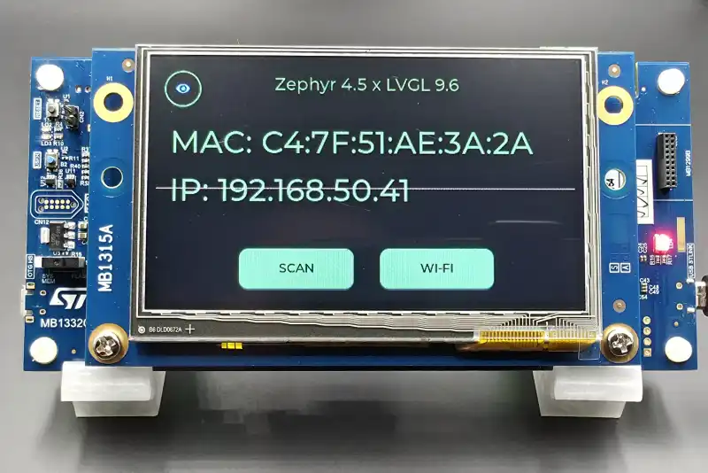
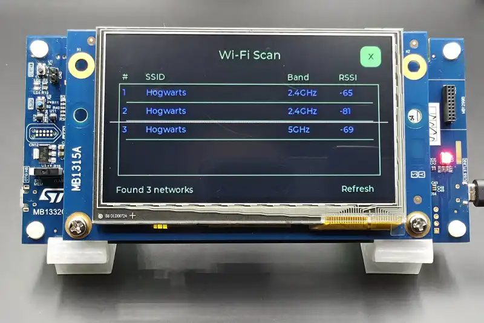
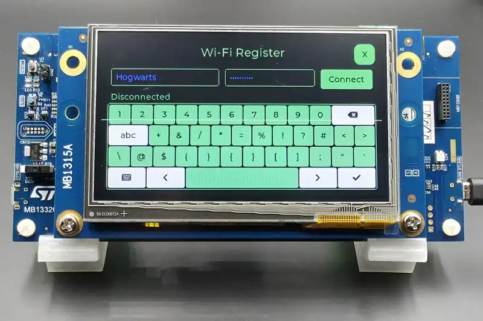

# STM32H7B3I-DK — Wi-Fi Demo

**Zephyr RTOS × LVGL × STM32H7 × Wi-Fi**

A demonstration of **Zephyr RTOS 4.5.0** and **LVGL 9.6.0** running on the **STM32H7B3I-DK** development board.
The application provides a touchscreen-based Wi-Fi manager using the onboard **Inventek ISM43340** wireless module.
Wi-Fi management is performed entirely through the graphical interface, without requiring a shell or serial console.

---


## Screenshots

| Home | Scan | Register |
|:---:|:---:|:---:|
|  |  |  |

---

## Features

### Display and GUI

- LVGL 9.6.0 graphical interface.
- STM32 LTDC display controller.
- Hardware-accelerated rendering using DMA2D.
- Double framebuffer configuration.
- External SDRAM for display buffers.
- Capacitive touchscreen support.
- PWM-controlled display backlight.
- Smooth screen and content transitions using PWM animations.

### Wi-Fi

- Inventek ISM43340 Wi-Fi module connected over SPI.
- Wi-Fi scanning on 2.4 GHz and 5 GHz bands.
- Asynchronous scanning using Zephyr network management events.
- Scrollable network list displaying:
  - SSID
  - Frequency band
  - RSSI
- WPA/WPA2-Personal network connection.
- Network disconnection.
- Connection status monitoring.
- MAC and IPv4 address display.
- On-screen keyboard for SSID and password entry.
- Automatic clearing of credentials when leaving the registration screen.

The application does not store Wi-Fi credentials or automatically reconnect after a restart.

### Architecture

The application separates the graphical interface from network management.

| Module | Description |
|---|---|
| `gui_wifi.c` | Screen navigation, PWM transitions and network information |
| `gui_wifi_scan.c` | Wi-Fi scanning interface and network list |
| `gui_wifi_register.c` | Wi-Fi connection interface and on-screen keyboard |
| `wifi_connection.c` | Wi-Fi connection management using Zephyr networking APIs |
| `backlight.c` | PWM backlight control |

Network events are processed asynchronously using Zephyr `net_mgmt` callbacks and message queues.

LVGL objects are updated exclusively from the GUI thread.

---

## Build

### Environment

Create and activate the Python virtual environment:

```bash
python3 -m venv ~/zephyrproject/.venv
source ~/zephyrproject/.venv/bin/activate
cd ~/zephyrproject
```

The environment must contain an initialized Zephyr workspace with the required dependencies.

### Compile

```bash
west build -p always \
-b stm32h7b3i_dk \
"$HOME/VSCodeProjects/zephyr-lvgl/applications/stm32h7b3idk_wifi_demo"
```

### Flash

```bash
sudo "$(which python)" "$(which west)" flash -r openocd
```

The application uses the board's onboard ST-LINK debugger.

---

## Usage

### Scan

Select **SCAN** on the main screen to discover nearby Wi-Fi networks.
The application displays the SSID, frequency band and signal strength of each detected network.
Use **Refresh** to repeat the scan.

### Connect

Select **REGISTER** on the main screen.

1. Enter the network SSID.
2. Enter the Wi-Fi password using the on-screen keyboard.
3. Select **Connect**.
4. Wait for the connection result.

The connection status is updated automatically.
After a successful connection, the main screen displays the network interface's MAC and IPv4 addresses.

### Disconnect

When connected, the **REGISTER** button on the main screen changes to **WI-FI**.
Select **WI-FI** to open the connection management screen.
Use **Disconnect** to terminate the connection.
The registration form and on-screen keyboard become available again after disconnection.

---

## Testing Wi-Fi Module

The Wi-Fi shell is optional and is not required for normal application operation.
To enable command-line testing, enable the Zephyr shell and Wi-Fi shell configuration options, including:

```ini
CONFIG_SHELL=y
CONFIG_WIFI_SHELL=y
CONFIG_WIFI_ESWIFI_SHELL=y
```

Additional console configuration may be required depending on the project settings.

### Scan

```bash
wifi scan
```

### Connect

```bash
wifi connect -s "ssid" -k 1 -p "pass"
```

### Check

```bash
wifi status
net iface
```

### Disconnect

```bash
wifi disconnect
```

For normal GUI operation, the shell components can remain disabled.

---

## Notes

- Wi-Fi credentials are not stored in non-volatile memory by the application.
- Network connection and disconnection are handled asynchronously.
- IPv4 configuration is managed by the Inventek eS-WiFi driver.
- Wi-Fi frequency bands are identified using the reported network channels.
- GUI transitions use hardware PWM backlight control instead of software opacity animations.
- The application is intended for demonstration and development purposes.

---
